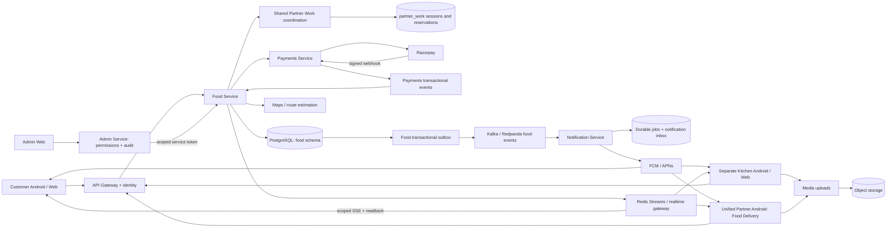
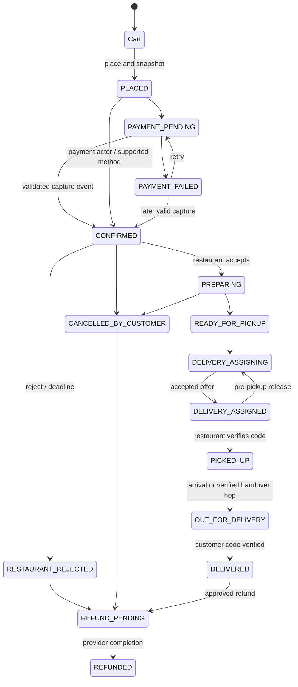

# Food Platform Audit

Audit date: 12 October 2026. Scope: Food customer Android/web, separate restaurant Kitchen Android/web, Food Delivery in the unified Partner Android app, Food admin web, and their supporting services. This is a source-and-read-only-runtime audit, not a production certification.

## 1. Executive Summary

The Food platform is **not merely a sample UI**. A substantial, persisted ordering system exists: restaurant onboarding and menu editing, customer carts, server pricing, gateway payment confirmation, restaurant acceptance, sequential delivery offers, pickup/drop verification, tracking, refunds and settlement calculation. Rebuilding these would waste existing work.

It is also **not yet a complete production Food ecosystem**. Important gaps sit between otherwise real components:

- Checkout does not revalidate saved cart item/variant/add-on availability, and restaurant minimum order is not enforced there. A supplied variant ID is also not bound to the selected dish before its price is used.
- Approving a support refund request changes its status but does not invoke the implemented payment refund command. Direct order refunds and system rejection refunds are separate, implemented paths.
- Restaurant earnings labelled “Your payout” use a different and incorrect basis compared with the settlement engine.
- Kitchen push delivery still has an at-most-once failure window. Customer and delivery notification paths have stronger durable-job handling.
- Customer review, chat, support, refund-request and substitution APIs exist without corresponding complete Food customer journeys.
- Normal Food dispatch excludes partners already holding a pending offer, despite the newer three-offer inbox capability.
- Failed delivery, exhausted verification attempts and no-driver situations lack a complete operational recovery journey.
- Settlement records and manual paid references exist; automatic bank disbursement and genuine provider/bank reconciliation do not form a complete Food finance flow.

### Checklist-derived completion

| Area | Complete | In-scope checklist rows | Future rows excluded | Completion |
|---|---:|---:|---:|---:|
| Customer Android + web | 16 | 39 | 2 | 41.0% |
| Restaurant/Kitchen partner | 18 | 31 | 3 | 58.1% |
| Food Delivery partner | 12 | 23 | 2 | 52.2% |
| Food admin web | 10 | 24 | 1 | 41.7% |
| Backend/infrastructure | 6 | 16 | 0 | 37.5% |
| **Overall** | **62** | **133** | **8** | **46.6%** |

There are 141 audited checklist rows in total, including eight future items. Basic ordering is substantially further along than this broad ecosystem completion number; the checklist also includes support, administration, finance and reliability.

Method: each feature row in sections 3–7 counts once. Completion = rows marked COMPLETE / all rows except FUTURE. PARTIAL, BROKEN and BACKEND_ONLY earn no fractional credit. Overall is the sum of completed rows divided by the sum of in-scope rows, not an average of percentages. Grouped rows require all named elements for COMPLETE. This measures the audited implementation checklist, **not engineering effort, test coverage or percentage ready for production**.

Classification: ✅ COMPLETE; 🟡 PARTIAL; 🔴 MISSING; ⚠️ BROKEN; 🔵 UI_ONLY; 🟣 BACKEND_ONLY; ⚪ FUTURE. No UI_ONLY label is assigned merely because a design is basic. Missing findings mean no meaningful implementation was found in the inspected active Food routes/clients/services, not a claim about unrelated repositories.

“COMPLETE” means the inspected implementation chain appears functional. Real-device/provider execution remains **Needs Verification** unless explicitly evidenced below. Uncertainty is called out independently from implementation status.

### Audit boundaries and runtime evidence

- Source inspected in `modernsmapp`, customer/restaurant web in `postbook-ui`, and admin source in `atpost-web-ui`; an older `atpost-web` clone was also compared. The working trees contain extensive pre-existing modifications. This is a working-tree audit, not a claim about one clean release commit.
- Docker readback showed running Food, payments, notification and admin services. Food is configured as `ENV=dev`; admin as local. Food's shared work coordination is enabled. PII keys/salt and platform GST identity are configured. These boolean checks did not expose credentials.
- Read-only database queries found 60 Food tables, three ACTIVE restaurant rows, one ACTIVE and one PENDING_REVIEW delivery profile, and two active service areas. These counts do **not** prove real, open restaurants or currently online, eligible riders.
- Payments stub allowance is false and a Razorpay webhook secret is configured. Live/test merchant mode, external webhook delivery and settlement into a real bank account are **Needs Verification**.
- No test orders, real charges, refund submissions, notifications, deployments, schema changes or source changes were performed for this audit. Only this report is created.
- Fresh focused tests passed for Food `internal/orderstate`, `internal/pricing`, `internal/settlement` and `internal/payments`. The first payment-test run was blocked by sandbox loopback socket restrictions; rerunning the same unit package with local test-server access passed. These tests did not contact Razorpay or mutate live records. Earlier broader test logs are contextual evidence only; they do not establish a complete four-persona Food transaction.
- Installed APK parity, published web/admin build provenance, all device permissions, Apple push behaviour, accessibility on physical devices, production backups/restore and production capacity are **Needs Verification**. No full interactive purchase-to-delivery was executed in this read-only audit.

## 2. Current Architecture

### Applications and responsibilities

| Surface | Actual source and responsibility |
|---|---|
| Customer Android | `mobile/android/app` hosts `feature/feast`; `core/food` contains Feast API/repository/DTOs. Shared authentication, payments, notifications and maps are reused. |
| Customer web | `C:/workspace/postbook-ui/src/features/feast/customer`; Next routes under `/feast`; shared API proxy, location and Razorpay integration. |
| Restaurant Android | Separate `mobile/android/app-kitchen`, using `feature/kitchen` and Kitchen/Food clients in `core/food`. Not the unified delivery app. |
| Restaurant web | `C:/workspace/postbook-ui/src/features/feast/kitchen`, under `/feast/kitchen`; onboarding, orders, menu and earnings. |
| Delivery Android | Unified `mobile/android/app-doorstep-pro` embeds Food `feature/rider`; `RiderApi`/`RiderRepository`, incoming requests and shared work-session coordination. Legacy separate rider sources are not evidence of the installed unified app. |
| Admin web | `C:/workspace/atpost-web-ui/apps/admin/src/app/food/page.tsx` and `components/food`; talks to admin-service, not directly to the Food database. The other admin clone differs; deployed bundle provenance needs verification. |

Food is mainly a Go domain service, not separate restaurant/cart/dispatch microservices. `cmd/server/main.go` configures payment/event consumers, outbox, restaurant response deadline worker, FSSAI expiry, dispatch, presence and refund retry. API Gateway routes `/v1/food` to it. Internal admin routes are separated from the public edge.

PostgreSQL stores orders, identities/relationships and finance; Redis Streams carry realtime hints; Kafka/Redpanda carries durable domain/payment events. Notification infrastructure uses PostgreSQL job/dedup state and Scylla-backed inbox integration. FCM/APNs are push transports. There is **no Food SignalR implementation** in the traced flow; Food uses SSE and polling/readback, not a Food WebSocket state machine.

### Database inventory and reuse

Existing tables cover restaurant profiles, hours, documents, images, cuisine links and service areas; menus/categories/variants/add-ons/stockouts; cart/items/add-ons; addresses; orders/items/add-ons/history; payments, refunds and refund requests; delivery profiles/documents/KYC/availability/locations/offers/assignments/batches/tracking; ratings and item reviews; support tickets/messages; order messages/substitutions; coupons/redemptions; loyalty/referrals; restaurant/delivery settlements and files; payout accounts; outbox/payment inbox/idempotency/audit/fraud.

Therefore, support/reviews/coupon/settlement work should **reuse existing models and routes**. A new parallel Order, DriverEarning or RestaurantDocument schema is not justified by this audit. Food schema evolution is concentrated in `database/setup.sql`, rather than a conventional ordered migration directory. Roll-forward/rollback and existing-data upgrade verification remain release work.

Weak areas: availability is not rechecked at purchase; support order references lack an ownership check; proof attachment accepts a URL rather than proving ownership of an uploaded object; reporting uses older decimal/float representations alongside integer-paise snapshots; settlement payment references are not evidence of bank transfer.

### Evidence index

Rows below cite these identifiers plus concrete functions/screens. Paths are the inspected working copies.

| ID | Exact source / chain |
|---|---|
| E01 | [Customer web client](C:/workspace/postbook-ui/src/features/feast/customer/api/client.ts), `screens/HomeScreen.tsx`, `RestaurantScreen.tsx`, `CartScreen.tsx`, `CheckoutScreen.tsx`, `OrderDetailScreen.tsx`, `OrdersScreen.tsx`, `AddressesScreen.tsx`; `model/wire.ts`, `hooks/queries.ts`. |
| E02 | [Customer Android API](C:/workspace/modernsmapp/mobile/android/core/food/src/main/kotlin/com/us/android/core/food/network/FeastApi.kt), `repository/FeastRepository.kt`; `mobile/android/feature/feast/src/main/kotlin/com/us/android/feature/feast` checkout/cart/menu/tracking screens and ViewModels; customer `UsNavHost` wires Feast. |
| E03 | [Food routes](C:/workspace/modernsmapp/Architecture/services/food-service/internal/http/handler.go:44), `handler_b8.go`, `handler_rider_kyc.go`, `handler_support.go`; [service facade](C:/workspace/modernsmapp/Architecture/services/food-service/internal/service/service.go:405). |
| E04 | [Catalogue repository](C:/workspace/modernsmapp/Architecture/services/food-service/internal/store/postgres/store.go), [discovery/serviceability](C:/workspace/modernsmapp/Architecture/services/food-service/internal/store/postgres/customer_discovery.go), `serviceability.go`. |
| E05 | [Cart/place order](C:/workspace/modernsmapp/Architecture/services/food-service/internal/store/postgres/customer.go:363), `loadCart:838`, `lockIdempotency:984`, `addons.go:loadCartAddons`, `pricing/pricing.go`, `money.go`. |
| E06 | [Order state machine](C:/workspace/modernsmapp/Architecture/services/food-service/internal/orderstate/orderstate.go), repository `order_transition.go`, [restaurant/delivery operations](C:/workspace/modernsmapp/Architecture/services/food-service/internal/store/postgres/ops.go:370). |
| E07 | [Food payment orchestration](C:/workspace/modernsmapp/Architecture/services/food-service/internal/service/payments.go), `internal/payments/client.go`, repository `payment_events.go`, `tracking_payments.go`, `service/refunds_b3.go`. |
| E08 | [Payment webhook](C:/workspace/modernsmapp/Architecture/services/payments-service/internal/http/handler.go:1050), `internal/service/p0.go`, `internal/gateway/razorpay_provider.go`, shared `paymentsclient`. |
| E09 | [Tracking/payment readbacks](C:/workspace/modernsmapp/Architecture/services/food-service/internal/store/postgres/tracking_payments.go), `rider_navigation.go`, `service/realtime_token.go`; customer web `hooks/live.ts`, `hooks/payment.ts`, `model/tracking.ts`; mobile `feature/feast/tracking/OrderTrackingViewModel.kt`, `OrderTimeline.kt`, `FreshRider.kt`. |
| E10 | [Restaurant web client](C:/workspace/postbook-ui/src/features/feast/kitchen/api/client.ts), components `KitchenConsole`, `BecomePartner`, `onboarding/*`, `menu/MenuEditor`, `menu/DishDialog`, `orders/OrderBoard`, `orders/PickupCode`, `Earnings.tsx`. |
| E11 | [Kitchen Android API](C:/workspace/modernsmapp/mobile/android/core/food/src/main/kotlin/com/us/android/core/food/network/KitchenApi.kt), `FoodApi.kt`, `repository/KitchenRepository.kt`; `feature/kitchen` onboarding/menu/queue/earnings ViewModels; `app-kitchen` new-order alert integration. |
| E12 | [Restaurant readbacks](C:/workspace/modernsmapp/Architecture/services/food-service/internal/store/postgres/partner_b8.go:165), `partnerMenuCategories:474`, `onboarding/onboarding.go`; repository onboarding/compliance/menu-extra methods and `ops.go` owner predicates. |
| E13 | [Delivery API](C:/workspace/modernsmapp/mobile/android/core/food/src/main/kotlin/com/us/android/core/food/network/RiderApi.kt), `repository/RiderRepository.kt`; `feature/rider` onboarding, KYC, home/offers/job/location/money; `job/JobRules.kt`, `JobLocations.kt`. |
| E14 | [Delivery dispatch worker](C:/workspace/modernsmapp/Architecture/services/food-service/internal/service/delivery_dispatch.go), [candidate query](C:/workspace/modernsmapp/Architecture/services/food-service/internal/store/postgres/dispatch.go:42), `sequential_delivery.go`, `delivery_offers.go`, `delivery_batching.go`. |
| E15 | [Pickup and drop proof](C:/workspace/modernsmapp/Architecture/services/food-service/internal/store/postgres/delivery_proof.go), `ops.go:592`, `rider_navigation.go`; service delivery proof handlers and Rider API. |
| E16 | [Shared work coordinator](C:/workspace/modernsmapp/Architecture/shared/partnerwork/coordinator.go), `domains.go`; Food server installation and domain database guards; unified app `partner` work-session readback. |
| E17 | [Food delivery KYC](C:/workspace/modernsmapp/Architecture/services/food-service/internal/riderkyc/riderkyc.go), `service/rider_kyc.go`, repository `delivery_kyc.go`; `foodpii`, secure upload integrations. |
| E18 | [Food push routing](C:/workspace/modernsmapp/Architecture/services/notification-service/internal/service/food_push.go:203), `internal/events/food_consumer.go`, `food_review.go`, customer/partner durable notification jobs and shared mobile notification routing. |
| E19 | [Support repository](C:/workspace/modernsmapp/Architecture/services/food-service/internal/store/postgres/support.go:63), `service/support.go`, `http/handler_support.go`; unified Partner `FoodDeliverySupport.kt`. |
| E20 | [Admin Food proxy](C:/workspace/modernsmapp/Architecture/services/admin-service/internal/http/handler_food.go), [Food admin authorization](C:/workspace/modernsmapp/Architecture/services/food-service/internal/http/admin_token.go:140), gateway `pkg/adminsession/adminsession.go`, `pkg/internalroutes/internalroutes.go`, `cmd/server/main.go`. |
| E21 | [Admin approvals](C:/workspace/atpost-web-ui/apps/admin/src/components/food/FeastApprovals.tsx), `RestaurantDocuments:250`, `RiderKyc:135`; Food `ops.go:AdminApproveRestaurant/AdminApproveDeliveryPartner`. |
| E22 | [Admin orders](C:/workspace/atpost-web-ui/apps/admin/src/components/food/FeastOrders.tsx:30), [Admin operations](C:/workspace/atpost-web-ui/apps/admin/src/components/food/FeastOps.tsx), `FeastMoney.tsx`, `src/app/food/page.tsx`. |
| E23 | [Settlement calculation](C:/workspace/modernsmapp/Architecture/services/food-service/internal/settlement/restaurant.go), [settlement persistence](C:/workspace/modernsmapp/Architecture/services/food-service/internal/store/postgres/settlements_b3.go), `ops.go:AdminGenerateSettlements/AdminMarkRestaurantSettlementPaid`, `tracking_payments.go:AdminMarkDeliverySettlementPaid`. |
| E24 | [Reports](C:/workspace/modernsmapp/Architecture/services/food-service/internal/store/postgres/reports.go), `admin_stats.go`, [restaurant summary](C:/workspace/modernsmapp/Architecture/services/food-service/internal/store/postgres/tracking_payments.go:316), `partner_b8.go:PartnerSummaryMap`, `ops.go:DeliveryEarnings/DeliveryHistory`. |
| E25 | [Schema](C:/workspace/modernsmapp/Architecture/services/food-service/database/setup.sql), [server wiring](C:/workspace/modernsmapp/Architecture/services/food-service/cmd/server/main.go), Food outbox/payment inbox workers; Docker compose configuration. |

## 3. Customer App Status

Customer rows assess Android and web together; a missing journey on either is not scored as complete. Shared authentication and notification inbox exist outside the Food screens.

| Module | Feature | Status | Evidence | Missing Work | Priority |
|---|---|---|---|---|---|
| Location | C01 Detect location, near-me discovery | ✅ COMPLETE | E01 Home/current-location hooks → E03 restaurants → E04 serviceability/ranking | Device denial/recovery acceptance remains Needs Verification | P2 |
| Location | C02 Saved address CRUD | ✅ COMPLETE | E01 AddressesScreen + E02 address calls → E03 addresses → customer-owned rows | Verify upgrade data on device | P2 |
| Checkout | C03 Select saved/manual delivery address at checkout | 🟡 PARTIAL | E01 CheckoutScreen uses automatic `useCurrentAddress("feast")`; address CRUD is separate | Connect address selector; avoid requiring automatic lookup to proceed | P1 |
| Checkout | C04 Review/edit delivery contact | 🟡 PARTIAL | Address data supports contact; E01 checkout offers no complete contact editor | Explicit validated recipient/contact review on both clients | P1 |
| Discovery | C05 Restaurant search and cuisine filters | 🟡 PARTIAL | E01 Home filters loaded results; E03 restaurant query supports search | Server-backed search/pagination; not only first loaded page | P2 |
| Discovery | C06 Dish search | ⚠️ BROKEN | E03 `Search` returns empty `dishes` array | Actual dish search and customer integration | P2 |
| Discovery | C07 Cuisine/category discovery | 🟡 PARTIAL | Cuisines API/data exist; E01 derives cuisine filter from loaded restaurants | Complete catalogue-driven browsing across results | P2 |
| Discovery | C08 Recommended/top/fast restaurants | 🟡 PARTIAL | E03 `Home` assigns first six restaurants to top-rated and fast-delivery lists | Independent truthful ranking; current customer Home bypasses this placeholder payload | P2 |
| Discovery | C09 Trending/recently ordered discovery | ⚪ FUTURE | Order history exists; no dedicated active personalised discovery chain found | Product-approved ranking/recent module later | P3 |
| Discovery | C10 Offers/promotions discovery | 🟡 PARTIAL | E03 Home hardcodes FIGO50; coupons exist but are gated | Serve valid configured offers; connect customer promotion journey | P2 |
| Restaurant | C11 Details, image, cuisine, menu categories | ✅ COMPLETE | E01 RestaurantScreen/E02 repository → E04 restaurant/menu joins | No missing basic persistence chain found | P2 |
| Restaurant | C12 Open/closed, pause and coverage | ✅ COMPLETE | E04 hours/area/distance evaluation shared with PlaceOrder | Production supply configuration Needs Verification | P1 |
| Restaurant | C13 ETA, delivery fee, minimum order and hours presentation | 🟡 PARTIAL | E04 fields and E09 estimates; minimum check absent in E05 | Consistent displayed conditions plus enforceable minimum | P1 |
| Dish | C14 Details/image/price/discount/food type | ✅ COMPLETE | E01 ItemSheet and E02 menu UI → E04 menu item values | No mock pricing needed | P2 |
| Dish | C15 Variants/sizes/add-ons/customisation | ⚠️ BROKEN | UI/extras persistence exists; E05 accepts variant ID without checking it belongs to selected dish, then loads its price | Enforce variant-to-item association/availability at add and checkout; preserve working extras UI | P1 |
| Cart | C16 Add/remove/change quantity | ✅ COMPLETE | E01/E02 cart calls → E03 → E05 cart rows | Concurrent availability handled separately below | P1 |
| Cart | C17 Single-restaurant cart and persistence | ✅ COMPLETE | E05 user cart/restaurant and item relationships; clients read server cart | Cross-device UX test Needs Verification | P2 |
| Cart | C18 Saved-item availability at checkout | ⚠️ BROKEN | E05 AddCartItem checks availability; PlaceOrder/loadCart do not recheck item/variant/add-ons | Revalidate atomically before order/payment creation | P1 |
| Pricing | C19 Taxes, packaging, platform/delivery fees, final total | ✅ COMPLETE | E05 pricing engine and snapshots → E01/E02 paise decoders | Merchant/provider tax configuration still needs operational sign-off | P1 |
| Pricing | C20 Restaurant minimum order enforcement | ⚠️ BROKEN | E05 PlaceOrder does not use restaurant `min_order_amount`; only coupon minimum checked | Reject below-minimum orders authoritatively | P1 |
| Pricing | C21 Coupon validation/application | 🟣 BACKEND_ONLY | E03 `/coupons/validate`, E05 coupon calculation; absent active Feast customer client journey | Add customer controls only after gate and limit tests | P2 |
| Pricing | C22 Tips | 🔴 MISSING | No complete Food tip selection, order snapshot and earning allocation chain found | Define and implement if required for launch | P2 |
| Checkout | C23 Delivery instructions and item instructions | ✅ COMPLETE | E01/E02 request bodies → E05 snapshots → E10/E11 order detail | Test truncation/large text | P2 |
| Checkout | C24 Review and online payment method selection | ✅ COMPLETE | E01 checkout/payment hooks and E02 payment opener → E07/E08 | Real provider end-to-end Needs Verification | P1 |
| Checkout | C25 Order creation and retry identity | 🟡 PARTIAL | E01 persisted attempt key → E05 lockIdempotency; first-key insert race exists | Convergent concurrent replay and payload binding tests | P1 |
| Payments | C26 Provider success/failure and authoritative confirmation | ✅ COMPLETE | E07 intent/reference/amount checks → E08 signed webhook → E07 payment inbox | Verify configured merchant and webhook reachability with authorised test | P1 |
| Payments | C27 COD and wallet checkout | ⚪ FUTURE | Explicit capability gates default off; active customer launch UI uses online payment | Enable only with complete cash/wallet reconciliation operations | P3 |
| Orders | C28 Status timeline and restaurant progress | ✅ COMPLETE | E06 state/history → E09 readbacks → customer timelines | Semantic difference for OUT_FOR_DELIVERY documented in section 8 | P2 |
| Orders | C29 Assignment, driver detail, GPS/ETA | ✅ COMPLETE | E09 assignment/location readback, scoped SSE and fresh-location handling | Device background GPS/real travel test Needs Verification | P1 |
| Orders | C30 Call/chat restaurant or delivery partner | 🟣 BACKEND_ONLY | E03 order message routes exist; no complete active customer call/chat UI; rider contact restrictions E15 | Connect scoped chat/contact policy; notification event handler | P1 |
| Orders | C31 Customer cancellation | ✅ COMPLETE | E01/E02 cancel → E06 actor/state guard + history/refund path | UX must explain ineligible states rather than imply universal cancellation | P1 |
| Orders | C32 Order history | 🟡 PARTIAL | E01/E02 history → E05/E06 persisted rows; bounded list without full customer pagination | Pagination and retained access to older records | P2 |
| Orders | C33 Reorder | 🔴 MISSING | No active customer reorder operation found in E01/E02/E03 | Rebuild cart with current price/availability review | P2 |
| Orders | C34 Invoice/receipt | ✅ COMPLETE | E01 InvoiceView/E02 invoice → E03 invoice → stored snapshots | Verify rendered tax content against approved configuration | P2 |
| Reviews | C35 Rate restaurant, food/item and rider; write review | 🟣 BACKEND_ONLY | E03 rating/review endpoints + tables; not wired into E01/E02 active journeys | Post-delivery UI, validation/readback and error handling | P2 |
| Reviews | C36 Browse detailed reviews | 🟡 PARTIAL | Aggregate rating visible; item-review list API exists | Full customer review list/pagination integration | P2 |
| Support | C37 Ticket, conversation and refund request | 🟣 BACKEND_ONLY | E03 support/refund routes → E19; customer clients lack matching Food journey | Connect order-aware support; fix ownership validation | P1 |
| Refunds | C38 Refund status/readback | ✅ COMPLETE | E07 processed refund events and order payment readback → E01/E02 | Provider test Needs Verification; partial refund presentation needs explicit amount coverage | P1 |
| Substitution | C39 Replacement proposal/response | 🟣 BACKEND_ONLY | E03 order substitutions → stored substitutions; absent complete client flow | Both restaurant and customer controls + events | P2 |
| Notifications | C40 Customer Android notifications and taps | 🟡 PARTIAL | E18 durable customer jobs/shared mobile routing → order readback | Verify Food full flow foreground/background/unread/tap on installed build | P1 |
| Notifications | C41 Web realtime/background notification experience | 🟡 PARTIAL | E09 scoped SSE + polling in open page; shared web inbox | Closed-browser push not established; distinguish inbox from push | P2 |

## 4. Food Partner Status

This is the **separate restaurant/kitchen product**, not Food Delivery inside the unified Partner app.

| Module | Feature | Status | Evidence | Missing Work | Priority |
|---|---|---|---|---|---|
| Onboarding | R01 Authenticated registration and owner-linked restaurant | ✅ COMPLETE | E10 BecomePartner/E11 CreateKitchen → E03 partner create → E06 owner_user_id | Verify current Kitchen install/auth deployment | P1 |
| Onboarding | R02 Mobile/email verification | 🟡 PARTIAL | Shared identity authentication exists; restaurant contact fields separately editable | Demonstrate verified business-contact linkage; email ownership not proven | P2 |
| Onboarding | R03 Business, owner/contact and address data | ✅ COMPLETE | E10 basics/location + E11 FoodApi → E12 owner-scoped persistence | Approved sensitive edits need policy review (R09) | P1 |
| Onboarding | R04 Geolocation, service range and hours | ✅ COMPLETE | E10/E11 panels → E12 location/hours → E04 serviceability | Real coverage data Needs Verification | P1 |
| Onboarding | R05 FSSAI documents, readiness and submission | ✅ COMPLETE | E10/E11 upload/readiness → E12 missing-step logic → E21 document decision | Actual document/media retention test Needs Verification | P1 |
| Onboarding | R06 Bank information and account verification | 🟡 PARTIAL | Payout account storage/PII and panels exist; verification mode/config in E25 | Resolve pending account verification; no proof of real beneficiary validation | P1 |
| Approval | R07 Admin review/activation/rejection readback | ✅ COMPLETE | E21 decisions → E06 status → E12 readiness → E10/E11 | Notifications separate (R22) | P1 |
| Profile | R08 Name/description/contact/location/hours/minimum/packaging | ✅ COMPLETE | E10/E11 update clients → E12 patch owner guards | Minimum enforced separately under C20 | P2 |
| Profile | R09 Reapproval of material approved-profile changes | 🟡 PARTIAL | E12 patch and E06 profile update paths write fields; not a complete pending-change review model | Decide fields requiring reapproval and preserve approved effective version | P1 |
| Profile | R10 Logo/banner/images and cuisine editing | 🟡 PARTIAL | Image upload endpoint/media exist; no complete cuisine + multi-image management journey found | Full edit/remove/readback and media ownership/retention verification | P2 |
| Operations | R11 Accepting switch / temporary pause | ✅ COMPLETE | E10 AcceptingToggle/E11 availability → owner route → E04 acceptance gate | No missing basic pause chain found | P1 |
| Menu | R12 Category CRUD/order/archive | ✅ COMPLETE | E10 MenuEditor/E11 menu → E06 categories with owner guard | Migration/empty-category test coverage retained | P2 |
| Menu | R13 Dish CRUD/archive, price/discount/type/prep time | ✅ COMPLETE | E10 DishDialog/E11 menu → E06 item mutations | Server revalidation at purchase remains separate | P1 |
| Menu | R14 Variants/sizes/add-on groups/extras | ✅ COMPLETE | E10 menu extras + Kitchen client/repository → persisted variants/groups/add-ons → customer E04 | Concurrency at checkout C18 | P1 |
| Menu | R15 Dish image upload | ✅ COMPLETE | E10/E11 media upload → menu media reference → E04 customer menu | Physical-device upload/permission test Needs Verification | P2 |
| Menu | R16 Sold out / available toggle | ✅ COMPLETE | E06 SetMenuItemAvailability → customer listing/add-item filter | Existing carts not protected until C18 fixed | P1 |
| Menu | R17 Quantity inventory and scheduled availability | 🟡 PARTIAL | Availability and stockout data exist; no full scheduled inventory UI chain found | Stock counts/scheduled windows if product requires them | P2 |
| Orders | R18 Incoming queue, detail, instructions | ✅ COMPLETE | E10 OrderBoard/E11 KitchenQueueViewModel → kitchen-queue/owned order → DB | Real-volume/page limits noted in technical debt | P1 |
| Orders | R19 Accept/reject and response deadline | ✅ COMPLETE | E06 guarded transitions; E25 deadline worker; E11 countdown/idempotent actions | Real device timing/outage test Needs Verification | P1 |
| Orders | R20 Preparing/ready, prep time and rider status | ✅ COMPLETE | E10/E11 actions → E06 preparing/ready/assignment readbacks | Accepted is not a separate backend state | P1 |
| Orders | R21 Pickup verification | ✅ COMPLETE | E10 PickupCode/E11 verify → E15 owner/rider/code/state checks | Locked-code recovery still missing (D15) | P1 |
| Notifications | R22 Approval/corrections/payout notifications | 🟡 PARTIAL | Status readback works; E18 ignores restaurant approval/rejection/FSSAI and settlement events | Add merchant-specific inbox/push handlers, not delivery recipients | P1 |
| Notifications | R23 New order foreground sound/background push | 🟡 PARTIAL | E11 alert + queue realtime; E18 Kitchen direct dedup-before-send path | Durable retry and provider-outage recovery | P1 |
| Dashboard | R24 Today orders/sales/AOV/active/cancelled metrics | 🟡 PARTIAL | E10/E11 basic counts and all-time summary; E24 no complete today KPI set | Explicit date windows and truthful metrics | P2 |
| Dashboard | R25 Ratings/popular dishes/revenue charts | ⚪ FUTURE | No complete restaurant analytics dashboard chain found | Add after operations/finance correctness | P3 |
| Finance | R26 Gross/commission/refunds/net payout summary | ⚠️ BROKEN | E24 PartnerRestaurantSummary sums all final_amount; PartnerSummaryMap subtracts commission/refunds | Use settlement-consistent recognised amounts, exclude customer platform/delivery charges | P1 |
| Finance | R27 Settlement history and paid reference/status | ✅ COMPLETE | E10/E11 settlements → E23 persisted periods/status/reference | Paid flag alone does not establish transfer | P1 |
| Finance | R28 Detailed taxes/adjustments and downloadable partner statements | 🟡 PARTIAL | E23 detailed calculation/admin files; E10/E11 simplified partner view | Partner-authorised detailed statement/download integration | P2 |
| Finance | R29 Actual restaurant bank payout | 🟡 PARTIAL | E23 calculation + admin manual mark-paid; no complete transfer chain | Controlled manual payout workflow or reconciled provider disbursement | P1 |
| Promotions | R30 Dish discounts | ✅ COMPLETE | E10/E11 discount edit → E06/E04 → E05 pricing | No additional campaign engine needed for this basic feature | P2 |
| Promotions | R31 Restaurant/time-based/coupon/free-delivery campaigns | ⚪ FUTURE | Admin coupon base exists, not a merchant campaign suite | Product scope and funding rules first | P3 |
| Reviews | R32 View/respond to customer reviews | 🟡 PARTIAL | Ratings/reviews persist; no complete Kitchen review workspace/reply flow | Read-only moderation-safe view first; reply policy later | P2 |
| Support | R33 Restaurant complaints/conversation | 🟡 PARTIAL | E19 common tickets exist; not a complete Kitchen order-aware support surface | Merchant support UI and admin conversation integration | P1 |
| Access | R34 Manager/kitchen staff/order operator roles | ⚪ FUTURE | restaurant_partners and notification staff targeting exist; core edits enforce owner | Do not promise multi-staff permissions until explicitly designed/tested | P3 |

## 5. Delivery Partner Status

| Module | Feature | Status | Evidence | Missing Work | Priority |
|---|---|---|---|---|---|
| Onboarding | D01 Registration/shared OTP and Food category | ✅ COMPLETE | Unified Partner auth/category shell → E13 profile → E06 user-linked delivery profile | Existing-account installation test Needs Verification | P1 |
| Onboarding | D02 Personal/vehicle/selfie/identity/DL/RC | ✅ COMPLETE | E13 forms/uploads → E17 vehicle-aware KYC; bicycle differs from motor vehicle | Provider verification mode and permissions need live validation | P1 |
| Onboarding | D03 Bank verification/readiness | 🟡 PARTIAL | E17 protected bank/document storage and admin review | Real beneficiary validation and payout eligibility readback | P1 |
| Onboarding | D04 Approval/rejection/correction status | ✅ COMPLETE | E21 rider document decisions → E17/E06 → unified status readback + E18 events | Installed app error/status distinction test Needs Verification | P1 |
| Availability | D05 Online/offline and cross-category duty | ✅ COMPLETE | E13 availability → E16 coordinator/domain guards; enabled runtime flag | Two-device acceptance test not performed this audit | P1 |
| Availability | D06 Break/pause | 🟡 PARTIAL | Offline exists; active work cannot simply be abandoned | Explicit break-after-job UX if required; no separate timed-break flow | P2 |
| Offers | D07 Pickup/distance/earnings and category-labelled offer | ✅ COMPLETE | E14 offer DTO + E15 navigation/payout snapshot → E13/unified incoming host | Verify real configured payout rather than fixture amount | P1 |
| Offers | D08 Accept/decline/20-second expiry | ✅ COMPLETE | E14 database expiry/locking + E13 actions/shared notification controls | Real-device late-tap/concurrent race test Needs Verification | P1 |
| Offers | D09 Multiple simultaneous Food requests | ⚠️ BROKEN | E14 candidate query excludes any pending offer; creation/inbox allow up to three | Align live dispatcher with supported queue policy, preserve one accepted job | P1 |
| Dispatch | D10 Sequential eligible/fair automated assignment | ✅ COMPLETE | E14 freshness/radius/online/active checks; least-offered fairness; single live offer per job | Observe actual supply and fairness under load | P1 |
| Dispatch | D11 No-accept/manual intervention recovery | 🟡 PARTIAL | Unassigned remains stored; prior candidates skipped; no complete admin reassign console | Visible queue, escalation, explicit retry/reassignment resolution | P1 |
| Pickup | D12 Navigation/restaurant contact/arrival | ✅ COMPLETE | E13 JobLocations dial/navigation → E15 restaurant contact/location and guarded arrival | Maps provider/device launch test Needs Verification | P1 |
| Pickup | D13 Code-verified pickup | ✅ COMPLETE | E15 restaurant verifies rider code, persists PICKED_UP/history | Do not replace with unverified status button | P1 |
| Delivery | D14 Customer navigation/location and code completion | ✅ COMPLETE | E13 job → E15 owned assignment, PIN attempts, delivered transaction | Real route + customer-code test Needs Verification | P1 |
| Exceptions | D15 Wrong/locked pickup or delivery code recovery | 🟡 PARTIAL | E15 five-attempt protection and refusal; no complete controlled recovery journey | Admin-assisted reissue/recovery with audit | P1 |
| Contact | D16 Customer call/chat | 🟣 BACKEND_ONLY | Order message API exists; E15 deliberately withholds customer telephone; no rider chat UI | Approved contact policy + scoped UI/events | P1 |
| Proof | D17 Photo proof of pickup/delivery | 🟣 BACKEND_ONLY | E03 proof route → E15 AttachProofURL; no RiderApi upload chain found | Secure owned-media attachment and mobile capture/retry | P2 |
| Exceptions | D18 Failed delivery and return/resolution | 🟡 PARTIAL | Generic support and failure enum/history exist; no complete post-pickup failed-delivery action | Reason/evidence, admin disposition, financial/tracking outcomes | P1 |
| Support | D19 Delivery support tickets/conversation | ✅ COMPLETE | Unified FoodDeliverySupport → E19 create/list/detail/reply | Add structured assignment link after ownership fix | P2 |
| Earnings | D20 Today/completed/lifetime earnings | ✅ COMPLETE | E13 money view → E24 DeliveryEarnings assignment aggregates | Consistent business timezone needs work | P2 |
| Earnings | D21 Weekly ledger/adjustments/payout history | 🟡 PARTIAL | Delivery settlements exist; rider earnings/history are simpler aggregates | Partner-visible paid/pending periods and auditable entries | P1 |
| Earnings | D22 Tips/incentives/bonuses | ⚪ FUTURE | Settlement incentive/penalty columns are not a complete earning programme | No invented live values; define rules before enabling | P3 |
| History | D23 Completed/cancelled/failed history and detail | 🟡 PARTIAL | E24 last-100 query; E06 release erases previous assignment ownership | Durable release/cancellation audit and pagination | P2 |
| Performance | D24 Rating/acceptance/cancel/completion/on-time dashboard | ⚪ FUTURE | Ratings/admin SLA foundations, not full rider dashboard | Build once metrics definitions and base flow are stable | P3 |
| Notifications | D25 Foreground/background/tap/expiry handling | 🟡 PARTIAL | E18 durable partner jobs + unified incoming coordinator authoritative readback | Food production offers and all lifecycle event types need full device test | P1 |

## 6. Admin Status

| Module | Feature | Status | Evidence | Missing Work | Priority |
|---|---|---|---|---|---|
| Dashboard | A01 Orders/restaurant/rider/refund operational counts | ✅ COMPLETE | E22 Food dashboard → E20 stats → E24 aggregate SQL | Operational interpretation/freshness monitoring | P2 |
| Dashboard | A02 GMV/revenue/commission/AOV/customer/cancellation analytics | 🟡 PARTIAL | E24 GMV uses all orders; limited metric coverage | Paid/recognised definitions; missing KPIs, date windows | P1 |
| Restaurant | A03 Pending approval and document preview/decision | ✅ COMPLETE | E21 RestaurantDocuments → E20 scoped evidence/decision → Food documents | Confirm deployed admin is the inspected newer build | P1 |
| Restaurant | A04 Active/suspended directory and detail management | 🟡 PARTIAL | Backend status operations exist; E21 centres pending queues | Full operational directory with supported filters and status actions | P1 |
| Restaurant | A05 Commission/restaurant-specific settings | 🟡 PARTIAL | Commission snapshot/config exists; not complete per-restaurant admin editor | Permissioned effective-date configuration and audit | P1 |
| Delivery | A06 Pending approval, KYC, vehicle/document review | ✅ COMPLETE | E21 RiderKyc/ReviewApproval → E20/E17 decisions | Real evidence review acceptance test Needs Verification | P1 |
| Delivery | A07 Active/rejected/suspended directory, performance | 🟡 PARTIAL | Status APIs + report foundations; pending UI not full directory | Operational search/detail/performance links | P1 |
| Delivery | A08 Earnings and delivery settlement administration | ✅ COMPLETE | E22 FeastMoney → E20 → E23 settlement records/manual references | Automated payout separate (A15) | P1 |
| Orders | A09 Paged list, UUID lookup, detail/history | ✅ COMPLETE | E22 FeastOrders → E20 → E06 paged orders/detail | User-friendly order-number search separate below | P1 |
| Orders | A10 Global customer/restaurant/rider/date/payment/status search | 🟡 PARTIAL | E22 explicitly says filters apply only to current 50 rows | Server filters/indexes and preserved pagination | P1 |
| Orders | A11 Cancellation and full/partial refund initiation | ✅ COMPLETE | E22 reason/idempotent request → E20 → E06/E07 guarded financial action | Real provider refund readback Needs Verification | P1 |
| Orders | A12 Manual assignment/reassignment and failed-delivery operations | 🔴 MISSING | No complete route/control chain found in E20/E22 for safe manual reassignment | Atomic eligible reassignment plus financial/customer consequences | P1 |
| Moderation | A13 Prohibited item/review moderation | 🟡 PARTIAL | E22 moderation queue/decision, review deletion by ID → E20 | Browse full restaurant menus/reviews, complete investigation context | P2 |
| Catalogue | A14 Platform cuisine/category management | 🟣 BACKEND_ONLY | Cuisine/menu data and reads exist; restaurant categories managed by owners | Admin catalogue management API + UI; reads alone are insufficient | P2 |
| Finance | A15 Restaurant/delivery bank transfers | 🟡 PARTIAL | E23 generate/mark-paid and reference storage | Authorised transfer execution/reconciliation or documented manual controls | P1 |
| Finance | A16 Settlement generation/history/export | ✅ COMPLETE | E22 generation/files/download → E23 persisted calculations/files | Tax/adviser confirmation and overlap/late-refund tests before operational use | P1 |
| Finance | A17 Provider/bank payment reconciliation | ⚠️ BROKEN | E24 ReportPaymentRecon only groups Food order totals by payment status | Rename aggregate report; add real provider-to-ledger comparison | P1 |
| Finance | A18 Fee/tax/delivery-pricing/cancellation-rule configuration | 🟡 PARTIAL | E25 environment rules, snapshots, existing restaurant fields | Versioned admin controls or explicit managed configuration/runbook | P1 |
| Promotions | A19 Basic coupon CRUD | ✅ COMPLETE | E22 FeastCoupons → E20/E06 coupon rows | Customer gate/UI separately incomplete; concurrency hardening required | P2 |
| Promotions | A20 Campaigns/targeted/free-delivery/surge tools | ⚪ FUTURE | No complete campaign/surge suite found | Product/funding policy before implementation | P3 |
| Support | A21 Customer/restaurant/delivery complaints and refund disputes | 🟡 PARTIAL | E22 tickets/status and refund decisions → E19 | Full conversation/order/actor context, replies and resolution evidence | P1 |
| Coverage | A22 Service areas/cities/radius | ✅ COMPLETE | E22 FeastServiceAreas → E20/E06 → E04 serviceability | Confirm configured areas match real operating supply | P1 |
| Reports | A23 Restaurant/delivery SLA reports | 🟡 PARTIAL | E24 avg_accept_seconds NULL; delivery late uses fixed 30 minutes | Actual acceptance durations and promised ETA-based lateness | P2 |
| Security | A24 Fine-grained permissions/audit on console path | ✅ COMPLETE | E20 admin-service permissions → signed actor token → Food audit | Legacy route exception in B15/section 12 | P1 |
| Notifications | A25 Failed notifications and unassigned-job operations | 🟡 PARTIAL | Shared durable delivery job state exists; no complete Food admin recovery dashboard | Expose retry/dead-letter/unassigned visibility with permissions | P1 |

## 7. Backend Status

Paths here are relative to `/v1/food` unless stated otherwise. A dash means no missing basic API was found, not a blanket assurance about testing.

| Service/Module | Status | Existing APIs | Missing APIs | Problems |
|---|---|---|---|---|
| B01 Restaurant/onboarding | ✅ COMPLETE | `/partner/restaurants`, readiness/compliance/location/hours/FSSAI/payout and submit routes (E03/E12) | — for basic owner onboarding | Verification providers and active-profile edit policy need operational review |
| B02 Menu/customisation | ✅ COMPLETE | Restaurant categories/items; variant/add-on routes; customer menu (E03/E04/E12) | — for basic CRUD | Scheduling/quantity inventory incomplete; checkout validation separate |
| B03 Discovery/search | 🟡 PARTIAL | `/home`, `/restaurants`, `/cuisines`, `/search` | Real dish search/ranking | Empty dish list, static offer, reused first-six rankings |
| B04 Cart/checkout | ⚠️ BROKEN | `/cart`, `/cart/items`, `/orders` (E05) | No parallel cart service needed | Availability/minimum checks and initial idempotency-key race |
| B05 Order lifecycle | ✅ COMPLETE | Order detail/cancel; restaurant accept/reject/preparing/ready (E06) | — for normal state path | Exception recovery and status semantics documented separately |
| B06 Payment capture/idempotent events | ✅ COMPLETE | `/orders/:id/payments/intents`, confirm/payment; payments signed webhook (E07/E08) | — for normal gateway flow | Real external merchant/webhook validation pending |
| B07 Refunds | ⚠️ BROKEN | `/refunds`, admin refund/decide; direct order/provider refund commands (E07/E08/E19/E22) | Connect approved support request to existing refund command | Support decision changes status/realtime only; no caller of MarkRefundProcessed found. Request order/ticket ownership also unchecked. Direct order/system refunds are distinct working paths. |
| B08 Delivery profiles/KYC/availability | ✅ COMPLETE | `/delivery-partners/profile`, documents/availability/work-session routes (E03/E13/E17) | — for core registration | Identity/bank production provider verification pending |
| B09 Dispatch/offers/batching | 🟡 PARTIAL | `/delivery/offers/me`, accept/reject; assignment/batch APIs (E14) | Safe manual reassignment/escalation | Three-offer feature contradicted by candidate filter; exhausted supply recovery |
| B10 Pickup/drop/tracking | ✅ COMPLETE | Assignment arrival/tracking/location/verify-delivery; partner verify-pickup (E15) | — for normal verified delivery | Contact/proof/failed delivery/recovery need integration |
| B11 Promotions/reviews/loyalty/referrals | 🟡 PARTIAL | Coupon validate/admin CRUD, ratings/reviews, loyalty/referrals (E03/E25) | Campaign orchestration if approved | Largely not connected to active clients; coupon concurrency limits weak |
| B12 Support/messages/substitutions | 🟡 PARTIAL | Tickets/messages/refunds; order messages/substitution routes (E03/E19) | Admin conversation integrations as needed | Support order binding lacks ownership check; client/event gaps |
| B13 Notifications/realtime | 🟡 PARTIAL | Realtime token, event consumers, customer/partner durable jobs (E09/E18) | Merchant delivery-job/retry integration | Kitchen direct-send failure window; ignored merchant/chat/substitution events |
| B14 Finance/settlement/reporting | 🟡 PARTIAL | Generate/list/mark-paid/files/reports (E23/E24) | Reconciled disbursement and provider/bank reconciliation | Incorrect partner summary; manual transfer state; incomplete KPI formulas |
| B15 Authorization/privacy | 🟡 PARTIAL | Owner/assignee predicates, scoped realtime/admin tokens, PII encryption (E05/E15/E17/E20) | No new auth system needed | Legacy coarse admin route, support reference and proof attachment validation gaps |
| B16 Schema/events/operating infrastructure | 🟡 PARTIAL | Setup schema, transactional outbox/payment inbox, workers (E25), shared work (E16) | Operational health/recovery coverage, not necessarily new public APIs | Dev/local runtime; deployed source parity, disaster recovery and capacity Needs Verification |

## 8. End-to-End Order Flow

### Actual implemented happy path

1. Customer authentication/location → restaurant list/menu. Server serviceability checks restaurant state, accepting flag, hours, location and delivery area/range.
2. Item/variant/add-ons → user-owned, single-restaurant server cart. Add-time availability validation exists. Server calculates integer-paise pricing and tax breakdowns.
3. Customer reviews checkout → `POST /orders` with persisted idempotency key. Transaction validates ownership/serviceability, snapshots address/items/prices/taxes/commission, writes payment/order/history, clears cart and creates outbox event. It does not revalidate item availability or restaurant minimum.
4. Food requests gateway intent using server amount/reference. Customer opens Razorpay. Client success is advisory; real capture is applied from payments-service signed webhook/event with event deduplication, reference/amount/currency validation and Food payment inbox.
5. `CONFIRMED` order appears in Kitchen queue. Accept action moves directly to `PREPARING`; there is no distinct persisted `ACCEPTED_BY_RESTAURANT` state. Deadline worker can reject an unanswered order and request refund.
6. Restaurant marks ready: `READY_FOR_PICKUP` → `DELIVERY_ASSIGNING`. Worker creates a sequential 20-second offer, with restaurant grouping/batching support. Candidate selection requires ACTIVE, online, fresh location, coverage and no active work; fairness considers offers today/last offer/distance.
7. Rider accepts offer → `DELIVERY_ASSIGNED`, assignment initially `ASSIGNED`. The assignment API then supports `ACCEPTED` and restaurant arrival. Shared work guards coordinate duty/busy state and competing offers.
8. Restaurant verifies rider pickup code → assignment/order `PICKED_UP`. Rider navigates to customer; customer sees delivery code only in handover-eligible states.
9. Marking arrival at customer moves order to `OUT_FOR_DELIVERY`. If arrival is skipped, valid delivery-code verification records that intermediate hop immediately before `DELIVERED`. Thus raw status timing differs from ordinary “left restaurant” semantics; Android groups PICKED_UP/OUT_FOR_DELIVERY as on-the-way.
10. Valid customer code → transactional delivered assignment/order/history/outbox. Delivered assignments contribute to earnings. Settlement generation later creates restaurant/delivery payable records; admin can record a payment reference. This is not an automatic bank payout.

Diagram is abbreviated: admin cancellation applies in multiple non-terminal states; restaurant cancellation has its own actor-limited edges. See E06 for the complete transition table. `DRAFT` and `FAILED` exist in vocabulary, but ordinary placement starts with PLACED and there is no complete failed-delivery resolution path just because FAILED is defined.

### Alternative transitions and limitations

| Scenario | Actual handling | Gap / consequence |
|---|---|---|
| Restaurant rejection or response timeout | Rejected state/history + system refund request/retry for paid order | Push reliability and refund status delivery must be exercised |
| Customer cancellation | Guarded allowed states, history/refund path | Not allowed in every pending/payment/delivery state; UI must explain refusals |
| Admin cancellation | Permission/actor-gated cancellation; closes active offers/assignments | Verify downstream work release and refund outcomes end to end |
| Rider declines offer | Reject/expiry makes next candidate eligible | Existing recipients not endlessly re-offered the same job; no complete exhausted-pool admin recovery |
| Rider releases pre-pickup assignment | Assignment resets to CREATED with partner/code/batch removed; order re-enters assigning | Former rider’s history loses ownership linkage in this mutable row |
| Customer unavailable / delivery fails after pickup | Support exists; no full dedicated resolution state/action | Manual business decision cannot safely be represented by invented DELIVERED |
| Wrong handover code | Persistent attempt counter; lock after five failures | Controlled recovery route/UI not complete |
| Partial refund | Provider refund amount and payment event path exist | Do not assume all refund events make whole order REFUNDED; verify amount-aware UI |
| Admin approves a support refund request | E19 DecideRefund updates request status and publishes realtime hint only | No payment command/outbox linkage or caller of MarkRefundProcessed found; approving is not equivalent to executing a refund |
| Captured payment arrives after client failure | Event authority can confirm from failed/pending state | Correct pattern; do not trust client failure as proof no money moved |

### Required final flow

Keep the existing path. Add: selectable address/contact → final authoritative cart/minimum validation → convergent retry → durable Kitchen alert → explicit response deadline → reliable offer queue/acceptance → contact and verified pickup → clear en-route/arrival semantics → verified delivery **or controlled exception resolution** → consistent customer/restaurant/rider updates → reconciled refund/earnings/settlement.

### Realtime event map

| Producer / change | Transport and current consumer | Gap |
|---|---|---|
| Restaurant accept/preparing/ready | Food history/outbox; scoped Redis SSE; customer push/readback | Kitchen and customer offline/reconnect full flow Needs Verification |
| Ready order | Dispatch worker reads persisted assigning work; offers/outbox to rider | Candidate pending-offer filter prevents normal multi-offer filling |
| Driver assigned/cancelled/delivered | Domain events → customer durable notification jobs; scoped readback | Validate tap after terminal/cancel state, not stale payload navigation |
| Driver GPS | Location write → tracking readback/realtime hint; stale-fix handling | Device permissions/background upload and provider ETA require field test |
| Delivered | Customer event; restaurant reads order; admin reads orders/reports | No separate guaranteed admin push required; distinguish readback from push |
| Restaurant approval/FSSAI/settlement | Event vocabulary exists; consumer ignores relevant events | Merchant inbox/push missing |
| Order message/substitution/refund decision | Routes/data/events exist | Corresponding notification handlers and client journeys incomplete |

Web live hook refetches on stream connect/error and retains approximately ten-second polling recovery. This is redundant traffic but not automatically a bug: it protects against missed best-effort realtime hints. Optimise only after replay/reconnect reliability is established.

### Money flow

Food server amount/reference → payments-service intent → Razorpay → verified webhook → atomic payment ledger/inbox/outbox → Food event inbox/order confirmation. Direct order/system refund commands use deterministic provider identity and event reconciliation. The separate support-request approval route is not connected to those commands: its comment describes a future worker, but the implementation only updates the request and publishes a realtime hint. Restaurant settlement uses snapshotted supply/commission/tax components and processed refunds; platform and delivery charges are excluded from restaurant payable by the settlement calculator. Delivery settlements aggregate earned delivery amounts. Mark-paid records an operator-supplied reference; it does not call a bank-transfer provider. The “payment reconciliation” Food report currently queries only Food order aggregates.

## 9. Critical Blockers

**No universal outage preventing every normal order was established.** Do not equate missing charts, reviews or promotions with inability to complete a basic order. The following are conditional blockers to real scenarios:

| Severity | Blocking scenario | Evidence / required resolution |
|---|---|---|
| P1 | User cannot obtain automatic delivery lookup in web checkout | E01 checkout blocks without chosen current address despite saved address APIs. Provide manual/saved-address fallback. |
| P1 | Restaurant is relying on a push alert and the provider send fails | E18 Kitchen dedup-before-send can consume the event without durable retry; unanswered paid orders can time out. Complete durable Kitchen delivery. |
| P1 | All eligible riders decline/expire or none are available | E14 retains unassigned order, but there is no complete admin dispatch recovery. Provide visible escalation, controlled retry/reassignment/cancellation. |
| P1 | Delivery code is locked, customer unreachable or delivery fails after pickup | E15 refuses completion correctly; recovery/failed-delivery/contact journeys incomplete. Provide audited operational resolution. |
| P1 | Sold-out item already exists in customer cart | E05 accepts stale availability; a real restaurant may be unable to fulfil that accepted order. Revalidate before payment. |

P0 means launch/order completion blocker, P1 major functionality, P2 important non-blocking, P3 enhancement. No verified platform-wide P0 is asserted here. Production readiness remains **Needs Verification** until one authorised real four-persona/provider test, supply configuration and release parity are proven. Finance display errors and authorization concerns are serious release issues, but are not falsely placed in this section as universal checkout blockers.

## 10. Missing Features

### Customer

Complete checkout location/contact selection, real dish search, server-paged discovery/history, reorder, review/rating submission and browsing, support/refund-request/chat, substitution response and actual promotion integration. Tips require a complete money allocation design, not just an input. Closed-browser push is separate from an open web inbox.

### Food Partner

Durable new-order alert delivery; approval/correction/compliance/settlement alerts; accurate payable summary and statements; fuller profile images/cuisine editing; material-change review policy; order-aware support; complete review workspace. Quantity inventory/scheduling are partial. Advanced staff roles, revenue charts and campaign tooling are future work, not reasons to rebuild current onboarding/menu/order operations.

### Delivery Partner

Real multi-offer dispatcher integration; no-supply recovery; scoped customer contact; capture/upload proof; failed-delivery/locked-code operations; historical assignment retention and pagination; visible payout ledger. Advanced incentives/performance dashboards are future scope.

### Admin

Full active/suspended partner directories, global order search, safe reassignment/exception handling, complete complaint conversations, per-restaurant commission/configuration controls, catalogue administration, real reconciliation and failed-notification/unassigned queues.

### Backend

Atomic final cart validation/minimum; safe idempotency first insert; merchant notification durability/events; protected support-order association and owned proof media; consistent finance semantics; controlled exception transitions; server search/filtering/pagination. Reuse current support, reviews, refunds, settlement and work-coordination structures.

### Infrastructure

Verified release/source provenance, production-mode provider credentials/configuration, external webhook tests, outbox/retry age monitoring, production backup/restore exercises, retention rules and load/device-permission tests. Their absence from this audit's evidence is **Needs Verification**, not proof no such operational procedures exist elsewhere.

## 11. Integration Gaps

| Type | Exact finding |
|---|---|
| UI without complete backend behaviour | Multi-request inbox exists, but E14 normal dispatch excludes an already-offered Food rider. No evidence that a simulation proves live dispatch fills it. |
| UI with misleading backend calculation | E10/E11 restaurant payout summary reads E24 all-order gross minus commission/refunds, not E23 settlement payable. |
| API without active customer UI | Coupons, ratings/reviews, support/refund request, order chat, substitutions, loyalty/referral routes in E03 versus E01/E02 active clients. |
| API without rider UI | E15 proof attachment and order messages lack a complete RiderApi/mobile capture/chat journey. |
| Admin backend without complete operations UI | Suspend/status and reporting foundations do not provide an active partner management directory or safe manual reassignment console. |
| Mock/static implementation | E03 Home: static FIGO50 offer; TopRated and FastDelivery both `take(restaurants, 6)`. Search dishes is an empty array. These are not evidence that current customer Home uses fake restaurant records. |
| Development provider | DigiLocker has mock/dev mode and a production HTTP mode. Actual provider mode and a real identity validation transaction need verification; configuration defaults alone do not certify live KYC. |
| Missing event handling | E18 ignores restaurant approval/rejection, FSSAI expiry, settlement generated/paid, order messages, substitutions and some refund decisions. Delivery review events have a separate implemented path. |
| Missing durable send | Kitchen notifications fall through to direct at-most-once send, unlike new customer/delivery durable jobs. |
| Incorrect endpoint usage | No reproducible wrong path was established for core checkout, Kitchen accept, rider PIN or admin proxy; do not invent one. Deployed source mismatch remains unverified. |
| DTO mapping | Core clients explicitly decode rupee/paise fields. No specific confirmed wrong DTO mapping is claimed. Old float summaries and new paise snapshots are a verified consistency risk. |
| Missing closed-client realtime | Open web SSE does not equal browser push; closed browser delivery is not established. |
| Financial external integration | Settlement generation/mark-paid is not bank disbursement; Food payment aggregate is not gateway settlement reconciliation. |
| Disconnected refund execution | Support refund approval (`service/support.go:DecideRefund`) never calls the existing order-refund command. `MarkRefundProcessed` exists only as a store method; a comment is not worker wiring. |

## 12. Technical Debt / Bugs

Verified source findings; impact statements are separated from live exploit/reproduction claims.

| ID / priority | Finding | Exact evidence and impact |
|---|---|---|
| BUG-01 P1 | Cart availability not revalidated | E05 `loadCart` joins menu/variant prices without active/available predicates; `PlaceOrder` uses that cart. Add-time checks do not protect later sold-out changes. |
| BUG-02 P1 | Restaurant minimum not enforced | E05 PlaceOrder/pricing path has no restaurant minimum test; `min_order_amount` appears in profile/discovery and coupon validation, not restaurant purchase constraint. |
| BUG-03 P1 | Misleading restaurant payable | E24 `PartnerRestaurantSummary` sums all orders' final_amount and all refund rows; `PartnerSummaryMap` subtracts commission/refunds. E23 excludes customer platform/delivery charges and uses delivered/processed rules. E10 calls the first result “Your payout.” |
| BUG-04 P1 | Merchant push can be lost | E18 `runFoodPush` claims event dedup before provider send. A failed first send has no equivalent durable Kitchen delivery job. |
| BUG-05 P1 | Live multi-offer contradiction | E14 `ListDispatchCandidates` NOT EXISTS any pending offer versus sequential insertion limit of three/shared inbox. Existing offer blocks another normal Food offer. |
| BUG-06 P2 | Concurrent first idempotency key error | E05 `lockIdempotency` SELECT FOR UPDATE then plain INSERT when absent. Concurrent first calls can hit uniqueness error, not converge to replay. This is **not evidence of a duplicate charge**. |
| BUG-07 P1 | Support order reference not authorized on creation | E19 CreateTicket directly inserts caller-supplied OrderID; handler/service do not validate that the caller is customer/owner/assignee of that order. Ticket reads are owner/admin scoped. Proven reference-injection gap, not proven disclosure of another order. |
| BUG-08 P1 | Legacy Food admin authorization differs | E20 `/v1/food/internal/admin` checks signed permission/actor; legacy `/v1/food/admin` also admits coarse admin/superadmin scope. Gateway admin-session isolation recognises `/v1/admin`, not this legacy family. Fine-grained console permissions are therefore not the sole source-level enforcement path. Actual exposure to an issued end-user admin-scoped token is **Needs Verification**; do not describe this as anonymous access. |
| BUG-09 P2 | Mislabelled reconciliation/SLA reports | E24 payment recon is GROUP BY Food payment status, not provider matching; restaurant average acceptance explicitly NULL; delivery late threshold fixed at 30 minutes. |
| BUG-10 P2 | Unpaid/cancelled order amounts in headline metrics | E24 admin stats/restaurant summary aggregate final_amount without paid/delivered recognition filter. Define GMV separately from collected revenue/payable. |
| BUG-11 P2 | Search/history/filter truncation | E01 filters one loaded restaurant page; E22 admin filters current 50 rows only; E24 rider history last 100; E06 partner lists use bounded 100. Users can miss older/matching results. |
| BUG-12 P2 | Released rider history loses attribution | E06 DeliveryUpdateAssignment REJECTED resets delivery_partner_id NULL and status CREATED on same assignment. E24 history filters current partner ID, so it cannot show that released row for the old rider. |
| BUG-13 P2 | OUT_FOR_DELIVERY occurs at arrival/handover | E06 arrival transition and E15 verify fallback. Timeline labels must not imply a departure timestamp that was not recorded. Android's on-the-way grouping partly compensates. |
| BUG-14 P2 | Proof object ownership unverified | E15 AttachProofURL checks assigned user but stores provided URL. No object ownership/type binding in that function; harden before wiring camera UI. Not a proven server-side fetch/SSRF. |
| BUG-15 P2 | Coupon limit concurrency/case handling | E05 coupon validation reads used_count limit without a coupon row lock; increment matches code with a case-sensitive equality while lookup is case-insensitive. Feature is gated off by default; harden before activation. |
| BUG-16 P2 | Mixed money representations | E05/E23 authoritative snapshots use paise; E24 legacy aggregate interfaces still float/decimal + conversion. The summary bug is concrete; rounding loss in every order is not asserted. |
| BUG-17 P2 | Unnecessary duplicate semantic state/clients | E06 assignment and order status have distinct meanings; separate legacy/unified rider surfaces and differing admin clones exist. Consolidate contracts/provenance, not delete functioning code blindly. |
| BUG-18 P1 | Variant-to-dish association unchecked | E03 AddCartItem validates variant UUID syntax only; E05 service/store passes it through, schema has only a variant-ID foreign key, and loadCart joins variant on ID alone before using its price. A crafted request can associate another item's variant/price. Static path verified; no live tampering attempted. |
| BUG-19 P1 | Approved support refund never executed | E19 service DecideRefund calls store decision and realtime publish only. No payments command, durable execution event or caller of MarkRefundProcessed found in Food/payments services. Direct admin order refund and system cancellation/rejection refunds are not this route. |
| BUG-20 P1 | Refund request order/ticket binding unchecked | E19 handler checks authentication and positive amount; service/store insert order_id/ticket_id/customer_id directly. Ownership/relationship and refundable maximum are not checked on request/decision. Existing foreign keys only establish existence. This permits incorrect requests, not proof of unauthorised automatic disbursement (BUG-19). |

Security positives: customer ownership predicates on the core order/address/payment paths (not the separate support/refund-request exceptions above); restaurant owner predicates on CRUD/orders/pickup; rider ownership and ACTIVE checks on assignment transitions; scoped short-lived realtime tokens; actor/state validation; PIN attempt limits; signed admin-service permissions/actor; encrypted sensitive KYC/bank identifiers; raw card details are not stored by Food. These are source-traced controls, not a penetration-test certificate.

No specific unsafe-null crash or classic per-row application-query N+1 bug was confirmed. E04 batches menu variants/add-ons and serviceability facts. E14 uses lateral SQL and a 500-candidate prefilter, followed by in-memory geographic ranking; query-plan/load testing is needed before asserting it is slow. Some ancillary readback errors are suppressed (for example E05 restaurant-name lookup); distinguish best-effort display enrichment from authoritative payment/order failures.

## 13. Recommended Implementation Order

1. **Phase A — Correctness and release evidence.** Establish one build/source inventory. Fix variant binding, checkout availability/minimum and idempotency race; close support/refund-request/proof authorization gaps and retire or equally gate legacy admin routes. Connect approved support refunds to the existing payment command. Add regression tests before touching layouts.
2. **Phase B — Restaurant operations and truthful finance.** Correct payout summary using existing settlement semantics. Put Kitchen push on durable jobs; implement review/correction/compliance notifications. Validate actual restaurant onboarding, secure uploads, response deadlines and ready/pickup path.
3. **Phase C — Delivery recovery.** Align live dispatch with multi-offer inbox while retaining one accepted job and cross-category conflict checks. Add visible no-supply operations, customer contact policy, locked-code and failed-delivery recovery; preserve assignment history.
4. **Phase D — Customer/admin completion.** Saved/manual address selection, contact review, scoped support/chat/review/substitution integrations; global order/partner search and admin conversations. Do not recreate existing backend APIs.
5. **Phase E — Money operations.** Reconciled payout workflow, real provider/bank reconciliation, statements, tax/fee/commission configuration and late-refund/settlement-period tests. Keep customer charges separate from partner earnings.
6. **Phase F — Scale and polish.** Pagination, truthful discovery/promotions, health/retry visibility, accessibility/device/permission tests, load/backup/recovery evidence. Optional campaigns, staff roles and performance charts follow core launch acceptance.

Production deployment and provider tests require explicit approval after this audit. No implementation is started here.

## 14. Actionable Task Backlog

File references use the exact evidence paths in section 2. Each item is scoped to reuse existing infrastructure.

### FOOD-001 — Authoritative final cart validation

- **Area / Priority:** Customer + backend / P1.
- **Current:** Add-item availability checked; saved cart checkout ignores later item/variant/add-on changes and restaurant minimum.
- **Required:** Validate variant-to-item ownership at add and checkout, all selected options and required group constraints, active/available state, current restaurant minimum and price snapshot in the place-order transaction. Return actionable item errors without starting payment.
- **Files:** E05 `customer.go:PlaceOrder/loadCart`, `addons.go`, pricing; E01/E02 checkout.
- **Dependencies:** None.
- **Acceptance:** Another dish's variant rejected; sold-out/archive/removed variant/add-on after cart rejected; below minimum refused; valid unchanged order succeeds; simultaneous menu change/order tests; no order charge for rejected checkout.

### FOOD-002 — Convergent order idempotency

- **Area / Priority:** Backend/clients / P1.
- **Current:** Stored keys/replay exist; initial-key insert can race.
- **Required:** Atomic claim/replay with consistent in-progress response; bind key to intended request; preserve current client attempt persistence.
- **Files:** E05 `lockIdempotency`, E01 `model/checkoutAttempt.ts`, E02 checkout.
- **Dependencies:** FOOD-001 fixtures.
- **Acceptance:** Two simultaneous same-key submissions yield one order and deterministic readback; disconnect/retry never duplicates; changed payload with same key rejected explicitly.

### FOOD-003 — Merchant notification durability and lifecycle coverage

- **Area / Priority:** Notifications + Kitchen / P1.
- **Current:** Kitchen direct dedup-before-send; merchant review/FSSAI/settlement events ignored.
- **Required:** Persist merchant inbox/delivery jobs and retries; route to Kitchen audience only; deep links fetch authoritative account/order state. Retain time-sensitive expiry.
- **Files:** E18 `food_push.go`, `food_consumer.go`, shared durable jobs; E11 Kitchen alert/routing.
- **Dependencies:** Device registration/build provenance from FOOD-018.
- **Acceptance:** Foreground sound and background push for paid order; duplicate suppression; provider outage/restart recovery; expired action cannot ring as fresh; approval/correction/payment notice opens correct Kitchen page.

### FOOD-004 — Correct restaurant money summary

- **Area / Priority:** Restaurant + finance / P1.
- **Current:** Summary uses all order totals, including unpaid and platform/delivery components; settlement differs.
- **Required:** Reuse settlement component rules for recognised sales, deductions and pending/paid payable; label time period and distinguish estimate from bank payment.
- **Files:** E24 `tracking_payments.go:PartnerRestaurantSummary`, `partner_b8.go:PartnerSummaryMap`; E23; E10/E11 Earnings.
- **Dependencies:** Approved finance definitions; no new gateway required.
- **Acceptance:** Unpaid/cancelled orders do not inflate payable; customer delivery/platform fees excluded; processed partial refunds handled once; summary reconciles to settled period; Android/web render equal paise amounts.

### FOOD-005 — Real Food multi-offer dispatch

- **Area / Priority:** Delivery / P1.
- **Current:** Inbox/creation supports three; candidate query permits only a partner with zero live offers.
- **Required:** Apply the agreed pending-offer cap to normal dispatch; preserve one eligible partner per offered job, 20-second DB expiry, fair distribution and one accepted job globally.
- **Files:** E14 `dispatch.go`, `sequential_delivery.go`, `delivery_offers.go`; E16; E13/unified incoming host.
- **Dependencies:** None; coordinate with shared work rules.
- **Acceptance:** Three real sandbox orders can fill one available rider's queue; decline immediately reveals next; accept one revokes others across devices; expired/late accept refused; cross-category active work blocks offers.

### FOOD-006 — Unassigned and failed-delivery operations

- **Area / Priority:** Delivery/admin/backend / P1.
- **Current:** Unassigned work persists; post-pickup failures and code locks lack complete recovery.
- **Required:** Add authorised unassigned queue/escalation and controlled reassignment, failed-delivery reasons/evidence, recovery decisions/refunds. Never silently mark delivered or create duplicate work.
- **Files:** E14/E15/E06 state/dispatch; E20 admin proxy; E22 orders; E13 job.
- **Dependencies:** FOOD-005; product decisions for return/cancel/refund responsibility.
- **Acceptance:** All declines yield visible unassigned work; manual assignment enforces availability and scope; code-lock recoveries audited; unreachable customer/failed delivery reaches explicit terminal resolution; payment/work reservation released or reconciled correctly.

### FOOD-007 — Customer saved/manual checkout address and contact

- **Area / Priority:** Customer Android/web / P1.
- **Current:** Address APIs exist; web checkout depends on automatic current-location lookup.
- **Required:** Select/edit saved or manually searched location and recipient/contact, validate coverage, preserve order intent and consent.
- **Files:** E01 CheckoutScreen/AddressesScreen/shared current-address hook; E02; E04/E05.
- **Dependencies:** FOOD-001.
- **Acceptance:** GPS denied/offline lookup still permits saved/manual valid address; no silent address change; contact and instructions visible to permitted operational actors; out-of-area refusal clear.

### FOOD-008 — Secure order support and contact

- **Area / Priority:** All personas/backend / P1.
- **Current:** Tickets/messages exist, but ticket order binding unchecked; customer/Kitchen conversation surfaces incomplete; no rider customer contact.
- **Required:** Validate relationship on create/read/reply; integrate customer/Kitchen/rider/admin conversations; decide masked relay versus explicit number sharing and permission boundaries.
- **Files:** E19 handler/service/store, E03 order messages, E18 events, E01/E02/E10/E11/E13/E22.
- **Dependencies:** Contact/privacy product decision; FOOD-003 notification patterns.
- **Acceptance:** Foreign order association rejected; correct customer/owner/assignee/admin can access only allowed context; new replies notify proper recipient; stale/reassigned rider loses contact access; failures preserve drafted message.

### FOOD-009 — Retire or harden legacy Food admin entry points

- **Area / Priority:** Security/admin/backend / P1.
- **Current:** Fine-grained token-only mirror coexists with coarse legacy admin/superadmin route.
- **Required:** Inventory consumers; restrict all human Food administration through equivalent permission/session/CSRF/audit controls; close legacy public reach if unused.
- **Files:** E20 Food `admin_token.go`, gateway route/session policies, admin-service Food handler.
- **Dependencies:** Release/consumer inventory FOOD-018.
- **Acceptance:** Customer/merchant/rider denied; admin without each permission denied across every alias; forged headers ineffective; valid signed console action audited; no alternate path bypass.

### FOOD-010 — Global admin order/partner operations search

- **Area / Priority:** Admin/backend / P1.
- **Current:** Current-page order filtering and pending approval queues.
- **Required:** Server-side order number/customer/restaurant/rider/date/payment/state filters plus active/rejected/suspended partner directories/detail, using existing entities.
- **Files:** E22 FeastOrders/FeastApprovals, E20, E06 order listing/status methods.
- **Dependencies:** Permission definitions FOOD-009.
- **Acceptance:** Match on later pages found; filters/pagination stable; empty versus unavailable states distinct; document evidence remains protected; no unbounded full-table client download.

### FOOD-011 — Payout execution and genuine reconciliation

- **Area / Priority:** Finance/admin/backend / P1.
- **Current:** Calculations, exports, manual mark-paid exist; no verified transfer reconciliation chain; Food recon is only aggregates.
- **Required:** Agree controlled manual workflow or provider disbursement. Record actual external reference/outcome idempotently; compare gateway/bank settlements to internal captures/refunds/payables; surface discrepancies.
- **Files:** E23 settlement persistence/calculator, E24 reports, E22 FeastMoney, payments service as needed.
- **Dependencies:** FOOD-004, approved payout/tax rules and provider setup.
- **Acceptance:** Retry cannot pay twice; failed transfer not paid; pending/paid states reconcile externally; overlapping periods and late/partial refunds do not double-credit; customer charges never become rider/restaurant revenue improperly.

### FOOD-012 — Secure delivery proof and retain rider history

- **Area / Priority:** Delivery/backend / P2.
- **Current:** URL proof setter but no capture journey; releasing assignment overwrites previous partner ownership.
- **Required:** Use secure owned media with purpose/type/size/retention checks; mobile capture/retry; retain immutable assignment/release history and paginate it.
- **Files:** E15 AttachProofURL, E13 RiderApi/job; E06 release handling; E24 DeliveryHistory; media infrastructure.
- **Dependencies:** FOOD-006 exception design; reuse existing evidence architecture.
- **Acceptance:** Other user's media rejected; invalid URL not accepted as proof; interrupted upload recoverable; former rider sees permitted released-job history without current customer's contact; no duplicate completion earnings.

### FOOD-013 — Integrate reviews, refund requests and substitutions

- **Area / Priority:** Customer/Kitchen/backend / P2.
- **Current:** Backend endpoints/tables exist; active UI/event chain incomplete.
- **Required:** Connect existing contracts; require order participation/completion where appropriate; add refund request/status and substitution proposal/response with price consequences.
- **Files:** E01/E02/E10/E11 clients/screens; E03/E19; E18.
- **Dependencies:** FOOD-008, money rules FOOD-004/011 for price-changing substitutions.
- **Acceptance:** Verified purchaser can review once under defined edit policy; restaurant/rider/item ratings read back; customer approves/rejects replacement; refunds show requested/approved/processed amounts; duplicate actions safe.

### FOOD-014 — Truthful discovery, coupons and reorder

- **Area / Priority:** Customer/catalogue / P2.
- **Current:** Local restaurant filter, empty dish search, static Home offer/rankings; no reorder flow.
- **Required:** Real server-paged restaurant/dish/cuisine search; remove fabricated offers/rank labels; integrate valid coupon gate/limits; reorder through current menu validation.
- **Files:** E03 Home/Search; E04 catalogue; E05 coupon; E01/E02 discovery/cart/history.
- **Dependencies:** FOOD-001; promotion activation approval.
- **Acceptance:** Dish search returns actual available items; later pages discoverable; expired/unfunded coupon never advertised; case/concurrent cap tests; reorder reviews changed price/availability before charge.

### FOOD-015 — Complete restaurant profile and change-review policy

- **Area / Priority:** Restaurant/admin / P2.
- **Current:** Basic profile/onboarding works; incomplete cuisine/images workspace and approved-edit review semantics.
- **Required:** Finish media/cuisine editing and specify effective versus pending sensitive changes; preserve existing approved registrations.
- **Files:** E10/E11 onboarding/profile/menu; E12; E21 decisions; E18 notifications.
- **Dependencies:** Product list of reapproval fields; secure media conventions.
- **Acceptance:** Existing ACTIVE restaurant stays accurately represented; new sensitive change cannot silently replace verified effective data; correction reason shown; submit/retry doesn't duplicate registration.

### FOOD-016 — Consistent reporting and operational observability

- **Area / Priority:** Backend/admin/infra / P2.
- **Current:** NULL acceptance metric, hardcoded lateness threshold, ambiguous GMV and limited retry visibility.
- **Required:** Calculate actor timestamps from history; distinguish GMV/collected/recognised/payable; use promised ETA for on-time metrics; expose outbox age/retry failures/unassigned age and actionable alerts.
- **Files:** E24 reports/admin_stats; E22 reports; E18/E25 workers/health.
- **Dependencies:** FOOD-004/006/011 definitions.
- **Acceptance:** Seeded timestamp cases yield exact metrics; no NULL presented as zero; dead-letter/retry outage visible; recovery clears alert; query plans meet measured volume targets.

### FOOD-017 — State and money contract regression suite

- **Area / Priority:** Cross-platform QA / P1.
- **Current:** Useful unit/contract/database tests exist; no fresh full device/provider chain in this audit.
- **Required:** Reuse existing test harnesses for state/paise DTOs; isolated end-to-end fixtures for all actors, duplicates, denied permissions and interrupted networks.
- **Files:** E01/E02 client tests; Food orderstate/pricing/settlement/payment tests; E13/E16 dispatch/work guards; E20 permission tests.
- **Dependencies:** FOOD-001–009 fixes as applicable.
- **Acceptance:** One paid order through real sandbox webhook/Kitchen accept/rider pickup/drop; rejection/full/partial refund; no driver; payment outage; late duplicate notifications; cross-device offers; no live customer data mutation by fixtures.

### FOOD-018 — Establish release parity and production readiness evidence

- **Area / Priority:** Release/infra / P1.
- **Current:** Dev/local containers and differing admin clones; installed APK/source equivalence not established.
- **Required:** Record source revision/dirty snapshot, image digests, APK variant/version, provider modes, enabled flags and DB upgrade version. Verify rollout/rollback, backup restore, upload retention, device permissions and webhook reachability.
- **Files:** E25 Docker/server/schema, app build configuration, both web build pipelines, deployment records.
- **Dependencies:** Explicit approval before deployment/external transaction tests.
- **Acceptance:** Reproducible build inventory maps each running surface to reviewed source; existing approved records preserved; sandbox/live modes unmistakable; rollback and restore exercised; small screen/large text/keyboard and denied-permission tests documented.

### FOOD-019 — Optional post-MVP enhancements

- **Area / Priority:** Product / P3.
- **Current:** Staff, targeted campaigns, trending recommendations, incentives and richer performance charts are not complete.
- **Required:** Separately approve scope and metrics; do not block core delivery launch on promotional extras.
- **Files:** Existing restaurant_partners, coupon/rating/settlement tables and appropriate E10–E24 modules, only after design approval.
- **Dependencies:** Operational acceptance of FOOD-017/018.
- **Acceptance:** Each enhancement has explicit ownership, authorization, source-of-truth metrics and tests; no mock KPI/earning data presented as live.

### FOOD-020 — Execute approved support refunds safely

- **Area / Priority:** Support/finance/admin/backend / P1.
- **Current:** Support request creation does not verify order/ticket ownership; approval writes a verdict but never invokes payment refund execution. The direct order-refund machinery already exists.
- **Required:** Enforce customer/order/ticket relationships and remaining refundable amount. Make approval durably enqueue the existing refund command with a stable request identity; reconcile processing/provider outcomes into the support request. Do not duplicate payment-provider integration.
- **Files:** E19 `handler_support.go`, `service/support.go`, repository `support.go`; E07 refund command/events/outbox; E22 FeastMoney.
- **Dependencies:** FOOD-008 authorization, existing E07 refund infrastructure; FOOD-011 reconciliation conventions.
- **Acceptance:** Foreign order/ticket rejected; excessive amount refused; approved request creates one provider refund through the existing command; retries/restarts do not duplicate; provider failure stays visible; partial refund updates remaining balance and request state; customer notified only with truthful outcome.

**Audit stop point:** report only. Await approval before implementing any backlog item or changing/deploying the Food ecosystem.
